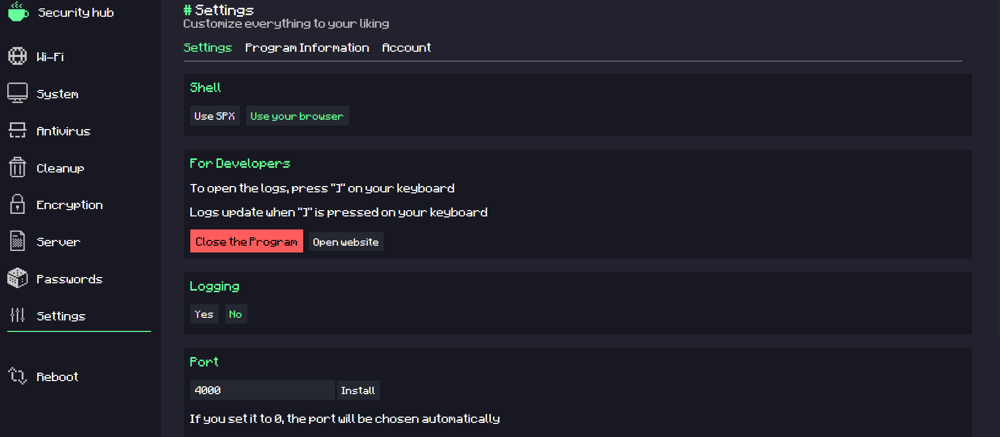

# Security Hub App

This project features a **modular architecture** designed for flexibility and scalability. It integrates several functional modules with the ability to dynamically manage them during runtime.

## 🧩 Features

- 🔐 **Encryption module** – Secure your data with built-in encryption tools.
- 💻 **System & Wi-Fi Information module** – Collect system and wireless network information.
- ☁️ **Remote File Storage** – Save files directly to a remote server.
- 🔑 **Password Manager** – Manage and store passwords securely.
- 📝 **User Registration** – Built-in registration module for user access management.
- 🔄 **Module Control** – Modules can be:
  - Enabled / Disabled
  - Removed
  - Reloaded

## 🧰 Technology Stack

- **Frontend:** Web-based user interfaces (HTML/CSS/JavaScript)
- **Backend:**
  - [Go](https://golang.org/)
  - [C++](https://isocpp.org/)
  - [Node.js](https://nodejs.org/)
  - [Python](https://www.python.org/)

🔗 **Site URL:**  
[Security Hub](https://spx-security-hub.wuaze.com/page/main?i=1)

### 🖼️ Screenshot  

---

### ℹ️ user test
**Name:** `ttts22r2`  
**Pasw:** `101010wrebdg`
